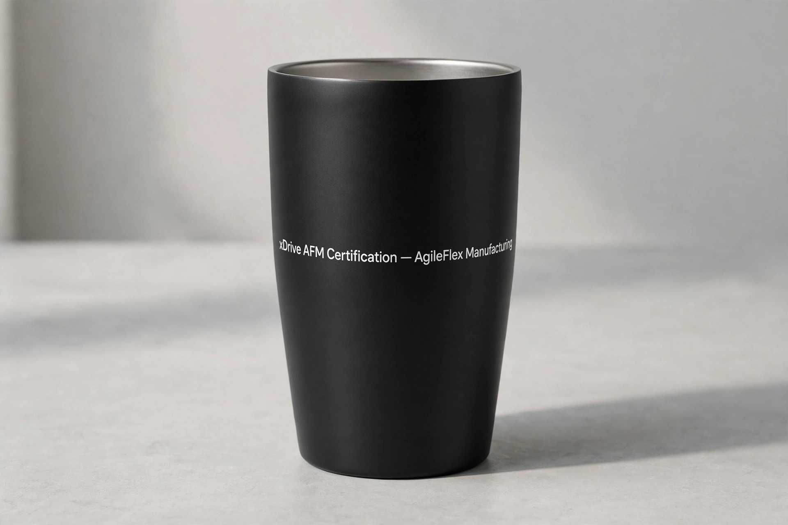
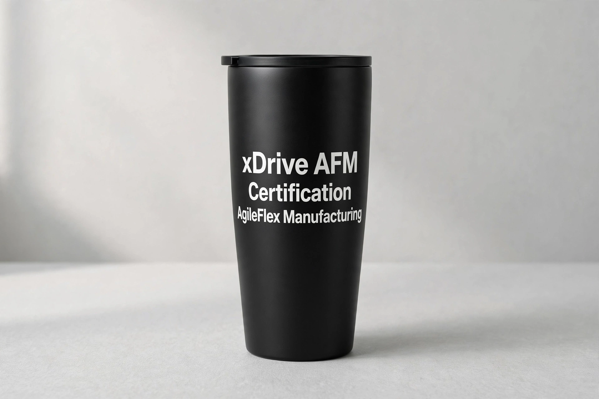
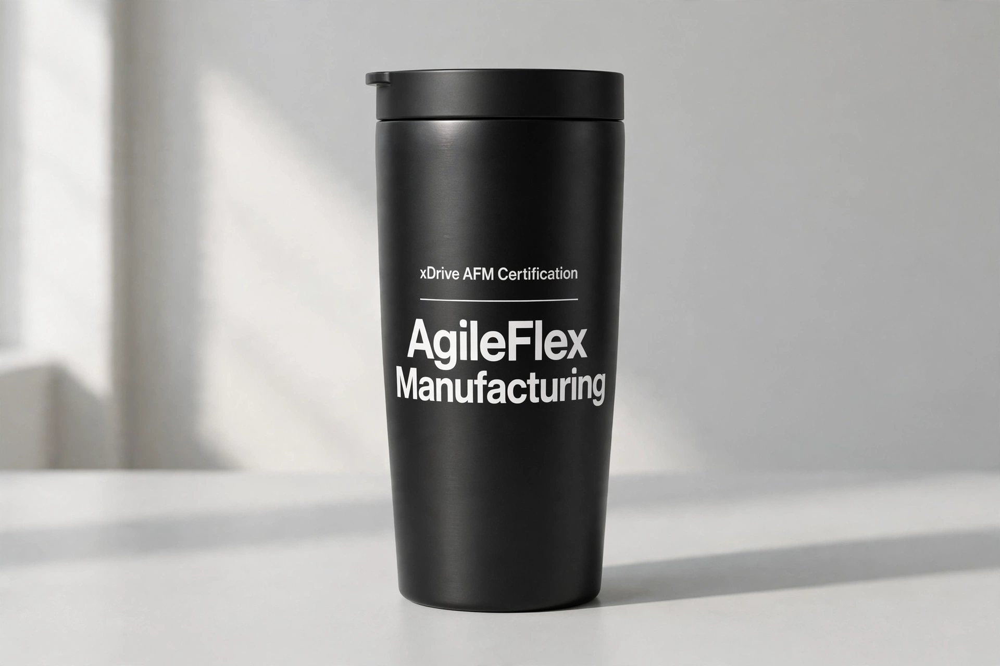
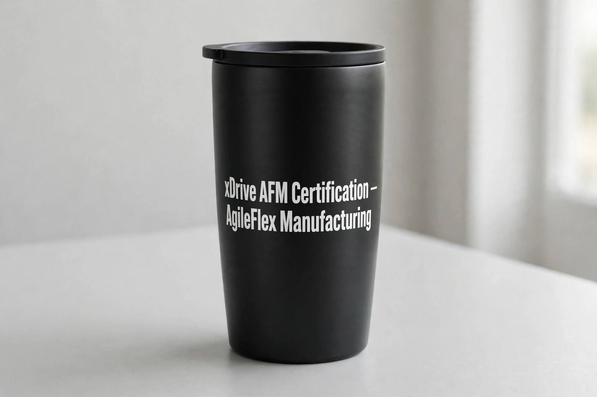
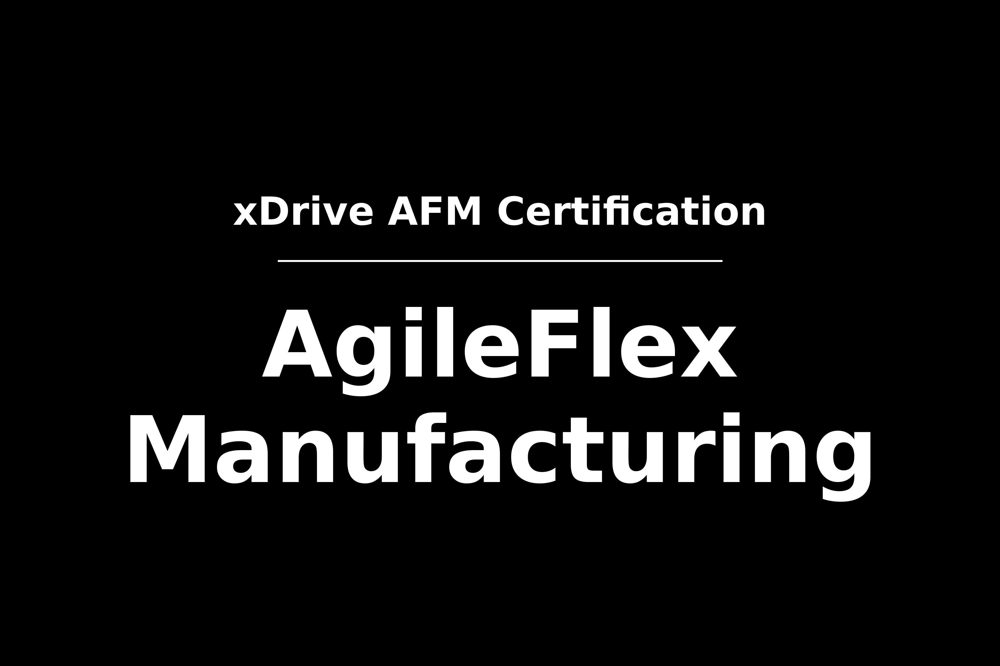

# Muse Chat Log — Example (streamlined)

The live Connect example for p2gift, served by the MCP as
p2gift://connect-examples/connect-example.md. Streamlined from
`Muse Chat Log-Example2.md` for use at the Connect stage:
deck summary shortened; pitch confirmed once (the original
repeats it); `xxxx` placeholder removed; "transparent
background" corrected to "white text on black" (the artwork
made was white on black).
Image assets are real files in examples/assets/ (mockup-tumbler.webp,
layout-a/b/c.webp, artwork-layout-b.png), not placeholders.

(user)

```
[file: xDRIVE_PPT_certification.pptx]
use p2gift: prepare a gift to match with this presentation PPT
```

(assistant)

```
Here's the p2gift run for this deck — 6 slides, in English, about
xDrive's AFM System certification: AgileFlex Manufacturing, lean
manufacturing and rapid turnaround, US military-centric
certifications across Taiwan, San Diego and Mexico, for DoD prime
contractors. San Diego is pitched as the certification hub.

the feature pitch —
xDrive AFM Certification — AgileFlex Manufacturing, US Military Certification, San Diego UAV Hub

Do you agree with the pick? Please confirm.
```

(user)

```
xDrive AFM Certification — AgileFlex Manufacturing
```

(assistant)

```
Understood — that's the full pitch, as-is:

xDrive AFM Certification — AgileFlex Manufacturing

Next is to pick the gift.
Click to view the available Keepsake Items. [view catalog](https://p2gift.keeg.uk/)

Here are the three p2gift concepts from that pitch:

1. Leather Notebook Set — for the partner / prime contractor
Pitch embossed on the cover. Professional, for the meeting where certification and partnership are discussed.

2. Tote Bag — for the conference / site visit
Pitch printed on the bag. For event participants and site visitors.

3. Stainless Tumbler (20 oz) — for the engineers and auditors on site
Pitch printed on the tumbler. Daily use on the factory floor and in the field.

Short pitch, so it fits all three in full — no condensing needed. No recipient profile given, so these are picked by topic: Professional / Partnership.

Which one — 1, 2, or 3?
```

(user)

```
I pick 3 — Stainless Tumbler (20 oz) https://p2gift.keeg.uk/images/catalog/b0fjlskf6v.jpg
```

(assistant)

```
Concept 3, confirmed — Stainless Tumbler (20 oz), with the mockup:


Pitch printed in white on the tumbler:
xDrive AFM Certification — AgileFlex Manufacturing

One small flaw to flag: the mockup adds a period after "Manufacturing" that isn't in your pitch. Keep it as-is, or want me to regenerate it?

If you approve this one, the next step is checkout — fulfilled manually, as usual.
```

(user)

```
add period
```

(assistant)

```
Fixed — regenerated without the period:


Now reads exactly:
xDrive AFM Certification — AgileFlex Manufacturing

No trailing period. Approved, or want another change?
```

(user)

```
change layout to 3 lines, increase font size
```

(assistant)

```
Done — 3 lines, larger font, no period:


xDrive AFM
Certification
AgileFlex Manufacturing

Note: the em dash is gone in this layout — the line break takes its place. Approved, or want the dash kept somewhere?
```

(user)

```
give three layout examples
```

(assistant)

```
Here are three layout examples, all with no period:

A — Centered, 3 lines, large
xDrive AFM / Certification / AgileFlex Manufacturing


B — Hierarchy, small top line + rule + large name
xDrive AFM Certification / — / AgileFlex Manufacturing, large


C — 2 lines, with the em dash kept
xDrive AFM Certification — / AgileFlex Manufacturing


Which layout — A, B, or C?
```

(user)

```
B
```

(assistant)

```
Confirmed — Layout B, the hierarchy one:

xDrive AFM Certification
——————
AgileFlex
Manufacturing

Small top line, rule, then AgileFlex Manufacturing large.

Want me to go to proceed with this one — Stainless Tumbler (20 oz), Layout B?
```

(user)

```
yes
```

(assistant)

```
Gift selection — Stainless Tumbler (20 oz), Layout B, pitch as in the mockup. I will keep the [image prototype B] jpg file in the record.

Next is to prepare a print-ready artwork. I need to apply the artwork on the surface of the selected gift.

Here is the artwork
- PNG, 3600 × 2400 px (12 × 8 in at 300 DPI), 112 KB
- White text on black, Layout B: small "xDrive AFM Certification", rule, then "AgileFlex" / "Manufacturing" large



Please review. Does this look good to you?
```

(user)

```
yes
```

(assistant)

```
Now I am ready to check out. I need two things — no price or delivery terms were ever set for this keepsake, so I won't invent them:

1. How many?
2. Deliver to whom, and where? (name + address)

Give me those, and I'll draft the order for your confirmation — including the price to confirm before anything is paid or made.
```
