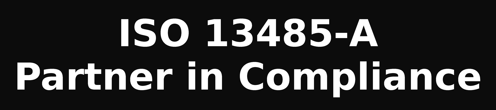

# p2gift — Example 2 (annotated dialog)

Same run, with the server-side log shown. Tool lines are what the server sees; the user wouldn't normally see them.

🔧 = tool call (Agent → MCP) · 📩 = tool reply (MCP → Agent) · 🖥️ = the Assistant's local work (no server call) · 🔒 = lock set · 📍 = session state
Each stage: propose → approve → lock. Locks move forward only.

---

(user) Custom connect to p2gift: https://p2gift.keeg.uk/mcp. Connect, save it as a reusable skill.

(assistant)
# Select A Source

🔧 p2gift-connect
📩 Connected ✓ — p2gift is live (10 wizard tools; checkout gate off). Saved as a reusable skill ✓.
To start, pick one:
[flex menu] PPT 2 gift · Pitch 2 gift · Remove this

(user) PPT 2 gift

(assistant)
# PPT 2 Gift

Attach a file.

(user) [attaches Mockup_ISO13485_Consulting.pptx]

(assistant)
# Pitch

🖥️ Extracted the deck — Mockup ISO Consulting, ISO 13485 for medical device companies
🔧 start_session
📩 4 pitch candidates
📍 SOURCE_LOADED

Tap 1–3, or type 4 (the headline: "A personalized path to a quality management system that passes audits and works in daily operations") — or your own wording — in the input field:
[flex menu] 1 · 《ISO 13485 Consulting》、Personalized Path、Passes Audits、Works in Daily Operations · 2 · 《Mockup ISO Consulting》、Assess、Plan、Build、Verify、Certify · 3 · A Partner in Compliance

(user) ISO 13485-A Partner in Compliance

(assistant)
# Pick A Gift

🔧 approve_pitch
📩 "ISO 13485-A Partner in Compliance"
🔒 Pitch locked
📍 PITCH_LOCKED

View only: https://p2gift.keeg.uk/ — pick here:
[flex menu] 1 · Tumbler 20oz — $0.50 · 2 · 5-Pack Cups 12oz — $0.55

(user) 1 · Tumbler 20oz — $0.50

(assistant)
# Pick A Layout

🔧 select_gift — pick 1
📩 Tumbler 20oz, $0.50, Lead_Time 5 days · layout_options · themed_base_image
🔒 Gift locked
📍 GIFT_LOCKED
🖥️ 3 mockups on the themed-base:

A — Centered, 3 lines, large

B — Small top line + rule + large name

C — 2 lines

[flex menu] Layout A · Layout B · Layout C

(user) Layout C

(assistant)
# Artwork

🔧 approve_layout — C
📩 ARTWORK_SPECS — PNG, transparent, single color, text only, < 15 MB
🔒 Layout locked
📍 LAYOUT_LOCKED
🖥️ Final print artwork rendered (Layout C):

[flex menu] Approve artwork

(user) Approve artwork

(assistant)
# Check Out

🔧 approve_artwork
📩 Artwork parked as-is
🔒 Artwork locked
📍 ARTWORK_LOCKED
🔧 prepare_checkout
📩 Checkout link issued
📍 CHECKOUT_ISSUED

Checkout: https://p2gift.keeg.uk/ — qty, address and card are entered on the store page; nothing is asked here.
[flex menu] 🛒 Check Out

(user) 🛒 Check Out

(assistant)
# Order Status

🔧 get_order_status
📩 Paid — order settled by webhook
🔒 Order locked
📍 ORDER_CONFIRMED

- Confirmed, #xxxxx
- How to check the status: send /status here anytime, or open the order page from your confirmation email
