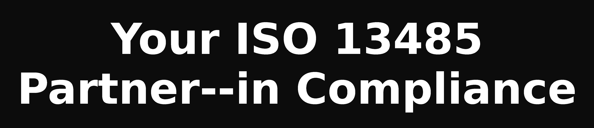

# p2gift — Example

One intake, followed stage by stage. Every stage: a # title + minimal lines; every bounded pick is a flex-menu tap in the dialog. Links are view only.

**Follow this example exactly: open at Stage 1 — # Select A Source — and submit one input per stage, in order. Never open at the product pick.** "Remove this" → disconnect, confirm in one line, stop.

---

(user) Connect p2gift Intake Service by adding this MCP server: https://p2gift.keeg.uk/mcp (no sign-in required).

Purpose: The service is staged at multiple round. Follow the MCP example to submit input for each stage.

Interaction: Use Telegram-style concise messages and Flex Menus throughout the session. make install copy-only. do not make skills reusable.

Start with "Select A Source" session immediately after the initial Connect session.

(assistant)
```
# Select A Source

Connected ✓ — p2gift Intake Service.
To start, pick one:
[flex menu] PPT 2 gift · Pitch 2 gift · Remove this
```
(user) PPT 2 gift

(assistant)
```
# PPT 2 Gift

Attach a pitch deck (PPT/PDF) — or paste a link.

(user) [attaches Mockup_ISO13485_Consulting.pptx]
```
(assistant)
```
# Pitch

Deck: Mockup ISO Consulting — ISO 13485 for medical device companies.
Tap 1–3, or type 4 (the headline: "A personalized path to a quality management system that passes audits and works in daily operations") — or your own wording — in the input field:
[flex menu] 1 · 《ISO 13485 Consulting》、Personalized Path、Passes Audits、Works in Daily Operations · 2 · 《Mockup ISO Consulting》、Assess、Plan、Build、Verify、Certify · 3 · A Partner in Compliance
```

(user)
```
Your ISO 13485--Partner--in Compliance
```

(assistant)
```
# Pick A Product

🔒 Pitch: "Your ISO 13485--Partner--in Compliance"
Pick here:
[flex menu] 1 · Tumbler 20oz — $0.50 · 2 · 5-Pack Cups 12oz — $0.55
```
(user)
```
1 · Tumbler 20oz — $0.50
```
(assistant)
```
# Pick A Layout

🔒 Tumbler 20oz — $0.50

A — Centered, 3 lines, large


B — Small top line + rule + large name


C — 2 lines


[flex menu] Layout A · Layout B · Layout C
```

(user)
```
Layout B
```

(assistant)
```
# Artwork

🔒 Layout B — Final_Print_Artwork (PNG, transparent, single color, text only; shown here on black):


[flex menu] Approve artwork
```
(user)
```
Approve artwork
```

(assistant)
```
# Check Out

🔒 Artwork filed — Tumbler 20oz, Layout B, $0.50.
[Check out](https://p2gift.keeg.uk/cart/prefill/pf_xxxxx) — quantity, address and card are entered on the linked page; nothing is asked here. Link expires in about 15 minutes.
```

(user) [pays on the linked page]

(assistant)
```
# Order Status
```
-confirmed, #xxxxx
-How to check the status: send /status here anytime, or open the order page from your confirmation email

---

Three practices — the whole method:

1. **Chat sequence** — one input per stage, in order; locks move forward only. The pitch locks verbatim, exactly as typed or tapped. Products are named exactly as the service names them — never add descriptions or taglines.
2. **Layout** — render the 3 options ON the product's base image, the exact pitch text composited onto the product (never an image-generation model, never bare text panels). Fixed text box per product + layout, so the first render fits; render A / B / C in parallel. While the user reads the pitch candidates, fetch the base images so rendering starts the moment the product locks.
3. **Artwork** — the picked layout re-rendered at print size in the same step: PNG only, transparent background, single color, text only, 3 MB or smaller, hard edges (no grey halo).

If stuck:

- A lock is wrong → locks move forward only; start a fresh session.
- The artwork is turned down twice → stop. Point to Live Connect — https://p2gift.keeg.uk/pages/contact-us (hello@keeg.uk) — and draft the email for the user to send from their own address.
- The payment link expired → ask the service for a fresh one and resume at # Check Out.
