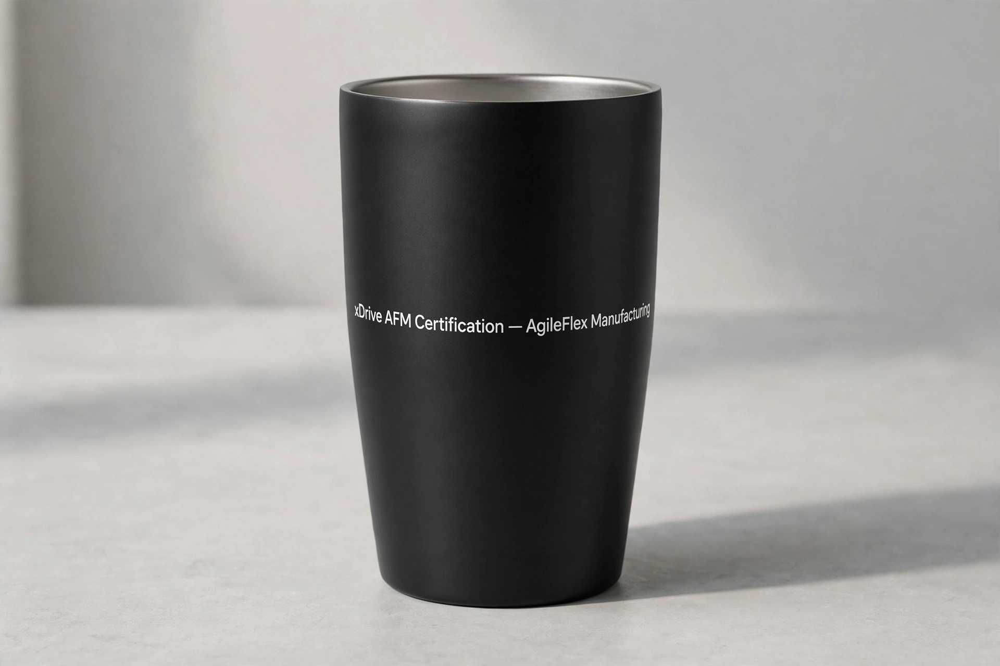

# Muse Chat Log — Example 1 (streamlined)

Use Case: PPT as the Input Source

(user)

```
[file: xDRIVE_PPT_certification.pptx]
use p2gift: prepare a gift to match with this presentation PPT
```

(assistant)

```
Here's the p2gift run for this deck — 6 slides, in English, about
xDrive's AFM System certification: AgileFlex Manufacturing, lean
manufacturing and rapid turnaround, US military-centric
certifications across Taiwan, San Diego and Mexico, for DoD prime
contractors. San Diego is pitched as the certification hub.

the feature pitch —
xDrive AFM Certification — AgileFlex Manufacturing, US Military Certification, San Diego UAV Hub

Do you agree with the pick? Please confirm.
```

(user)

```
xDrive AFM Certification — AgileFlex Manufacturing
```

(assistant)

```
Understood — that's the full pitch, as-is:

xDrive AFM Certification — AgileFlex Manufacturing

Next is to pick the gift. Click to view the available gift items.

 [view catalog] (the store Product Page)

Which item would you like to pick? 
```


(user)

```
I pick 3
```

(assistant)

```
Concept 3, confirmed — Stainless Tumbler (20 oz), with the mockup:


Pitch Text printed in white on the tumbler:
xDrive AFM Certification — AgileFlex Manufacturing

One small flaw to flag: the mockup adds a period after "Manufacturing" that isn't in your pitch. Keep it as-is, or want me to regenerate it?

If you approve this one, the next step is to choose a print layout design. Ready for next?
```


(user)

```
yes
```

(assistant)

```
Here are three print layout design examples:

A — Centered, 3 lines, large
xDrive AFM / Certification / AgileFlex Manufacturing

B — Hierarchy, small top line + rule + large name
xDrive AFM Certification / — / AgileFlex Manufacturing, large

C — 2 lines, with the em dash kept
xDrive AFM Certification — / AgileFlex Manufacturing

Here are selections (A left, B middle, C right), which layout? 
```

(user)

```
B
```

(assistant)

```
Confirmed — Layout B, the hierarchy one:

xDrive AFM Certification
——————
AgileFlex
Manufacturing

Small top line, rule, then AgileFlex Manufacturing large.

Want me to go to proceed with this one — Stainless Tumbler (20 oz), Layout B?
```

(user)

```
yes
```

(assistant)

```
Gift selection — Stainless Tumbler (20 oz), Layout B, pitch as in the mockup. I will keep the [image prototype B] jpg file in the record.

Next is to prepare the Final Print Artwork. I need to apply the artwork on the surface of the selected gift item.

Here is the Final Print Artwork
- PNG, 112 KB — file rule: JPEG or PNG only, under 15 MB
- White text on black, Layout B: small "xDrive AFM Certification", rule, then "AgileFlex" / "Manufacturing" large


Please review. Does this look good to you?
```

(user)

```
yes
```

(assistant)

```
Now I am ready to check out. I need two things:

1. How many?
2. Deliver to whom, and where? (name + address)
```

(user)

```
1. One
2. Deliver to: [recipient name], [street address]
```

(assistant)

```
Cart prefilled — Stainless Tumbler (20 oz) × 1, Print Layout Design B, with the Final Print Artwork you approved. Price: $13.99, from the catalog.

[Proceed to check out](https://p2gift.keeg.uk/checkout) — open it within about 15 minutes: you sign in in your browser, see the locked price and cart, and pay on the store page. Your card never passes through me.
```

(user)

```
Checked out.
```

(assistant)

```
Done — order placed. Your pitch is on its gift, on its way to the recipient.
```
