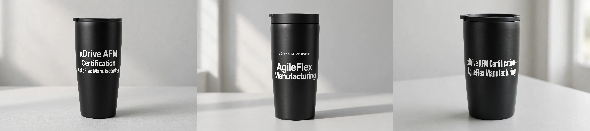

# Print Layout Design — Examples

The three print layout designs for printing a Pitch Text on a gift
item. The Agent gets them from the `suggest_print_layout` tool,
presents all three with their example images, and the user picks
A, B, or C. The pick is confirmed in the workflow at the mockup step
(`confirm_step`, `data.layout`).

Worked example — Pitch Text: "xDrive AFM Certification — AgileFlex
Manufacturing"; gift item: Stainless Tumbler (20 oz). These are the
same three designs shown in the default workflow example
(`p2gift://examples/default.md`).

## A — Centered, 3 lines, large

xDrive AFM / Certification / AgileFlex Manufacturing — centered,
large type. Line breaks take the place of the em dash.

## B — Hierarchy, small top line + rule + large name

xDrive AFM Certification (small top line), a rule, then AgileFlex
Manufacturing large. This is the design picked in the default
workflow example, and the one its Final Print Artwork is made from.

## C — 2 lines, em dash kept

xDrive AFM Certification — / AgileFlex Manufacturing. The em dash
stays, as part of the first line.

## All three in one image

The same three designs side by side in one image — A left, B middle,
C right. This combined image is the one shown in the default
workflow example.

## Rules for every design

- The Pitch Text prints exactly as confirmed — no added period, no
  rewording, no extra words.
- Only the arrangement changes: line breaks, type size, alignment.
- The chosen design (A, B, or C) is what the Final Print Artwork is
  made from — nothing is redrawn differently at the artwork step.
